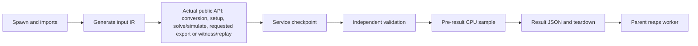

# Classical comparison: frozen source and qualification artifacts

**Completed bounded study:** all 2,700 selected workers finished, with 4,320
planned cells retained. This qualifies the recorded synthetic study and its
explicit limits; it does not establish general verifier competitiveness.

The measured source is `49f5c438fe8916d2d2abf0a1dd137c33fd752184`, tree
`18e930ff435de1591b144f34e69dbf408a6351d5`, based on integrated main
`332de59677bd5e21a125c5d6f6f5f43264b4b734`. Native ABI 5 binary SHA-256 is
`2a14a3eac241d2e4de22ebda12880505f8bf0b63b4d07f6a9c9460269b4a8bc4`.
`build.json` records the compiler, flags, Python ABI and C-source hash;
`freeze.json` records every frozen source hash. The binary itself is not
redistributed. A rebuild must record its actual hash rather than assume it
reproduces the recorded binary on another compiler or platform.

## Files and provenance

| File | Meaning |
| --- | --- |
| `results.json.gz` | Lossless raw result JSON, including every planned cell |
| `receipt.json` | Data hashes, exact counts, evidence boundaries and timestamp provenance |
| `report.json` | Recomputed primary mixed-study report; no timing imputations |
| `SHA256SUMS` | Integrity checksums for every other file in this directory |
| `freeze.json` | Exact source and native-binary identity attached to the measured read-only snapshot |
| `frozen-manifest.json` | Byte-identical manifest used by that snapshot, including its original labels |
| `build.json` | Receipt for the measured ABI-5 native binary |
| `environment.json` | Machine, Python, affinity and start-time observations; physical CPU exclusivity is not claimed |
| `requirements.txt` | Recorded environment dependencies; SymQ is installed separately from the exact source SHA |
| `development-qa.json.gz` | Lossless deterministic gzip of the completed development-only protocol qualification |
| `case-classification.json` | Explicit scientific classification erratum, bound to the measured source and raw manifest hash |

The development qualification ran 108 fresh workers on a separate four-wire
triangular-shear input, seed `811771`: 93 `ok`, 15 expected `unsupported`, and no
other status. It exercised all nine configurations, four tasks and three timing
boundaries. Its raw JSON SHA-256 is
`08f0dfd35a690fdaf30979cd2c4d56a8c94039be7fda903f7c345d63037a0342`;
gzip SHA-256 is
`2b15ca01b808e3d58f3f2a21783fc91a08d1ea5ed63eed38589221c9c6f45411`.
This is correctness/protocol qualification, not a performance holdout.

## Fixed selection and services

The comparison selects `fresh-affine-4`, `fresh-shear-5`, `fresh-increment-5`,
`adverse-nonlinear-14` and `adverse-nonlinear-18`, with 15 paired repetitions,
nine configurations and four tasks, solely at `public_api_end_to_end`:
2,700 requested fresh workers. The other three manifest cases are retained as
1,620 explicit `not_run` cells, giving 4,320 planned cells. Backend order within
blocks and block order are randomized with the frozen selection seed.

The tasks are symbolic simulation returning backend-native values, complete ANF
export, equivalence decision, and production plus concrete replay of a witness.
They are not interchangeable services. SAT and QCEC do not export ANFs through
these adapters; QCEC's adapter does not expose a concrete witness. No oracle
witness is credited to QCEC. The primary native configuration is
`zdd-native-fused`, the actual public native backend. `zdd-native` is a separate,
explicit Python-loop configuration; the faster mode is never chosen per case.

## Classification correction and analysis limits

The frozen manifest originally labels every case `new_holdout`. Static inspection
during the unchanged campaign found that the increment generator ignores its
seed: width-matched unit tests had already constructed the identical circuit.
Both increment cases are development calibrations, **not blind holdout cases**.
The erratum was recorded at `2026-10-30T00:13:26.346699+00:00` and published in
`8c0860067f3838ed5e16da9decf94d75f51b1363` before study completion. The raw
manifest, trial labels, selection and repetitions are preserved unchanged.

The preregistered mixed-study aggregate is retained with this disclosure. A
separate holdout-only sensitivity excludes the deterministic calibration. Only
two small stochastic families are eligible for exhaustive-oracle timing ratios
in that sensitivity; this is descriptive evidence, not population inference.
The larger adverse cases use fresh seeds but share one synthetic family. They
are copies with an adjacent cancelling gate pair, not independent compiler
optimization outputs. All generated circuits are SymQ MIT fixtures; no external
classical compiler corpus is claimed here.

The `fresh_*_holdout` adjudications describe first evaluation in this fixed study
only. Once evaluated here, the selected cases are explored evidence and cannot
be reused as an untouched holdout for future optimization claims. A confirmatory
successor needs new source-controlled external cases or fresh seeds. Unselected
affine-10/shear-10 remain `not_run`; increment-10 was already deterministic
calibration despite also being unselected. Historical raw labels are unchanged.

Latency comparisons require identical case/task/boundary/repetition pairs with
successful independent exhaustive checks. They use median paired ratios per
case, equal-case geometric means within each family, then an equal-family
aggregate. Repeats are not additional circuits or independent families.
Descriptive family-cluster resampling and leave-one-family-out sensitivity do
not establish general superiority. Above ten wires, algorithm-diverse agreement
is counted separately and never becomes an exhaustive-oracle flag or a timing
ratio. Timeouts, OOM, unsupported, inconclusive, errors and unrun cells remain
visible; failed or late work supplies no qualified verdict.

## Measurement boundaries and resource policy

The real public API functions load from `snapshot/src`, with dependencies from
the recorded environment. This is a source-snapshot timing study. Independent
wheel CI establishes installation behavior, not wheel performance.

The narrow public wall timer excludes input-IR generation, startup, IPC and
independent validation. The service wall/CPU guard additionally covers input
materialization and orchestration. Validation has its own budget. Worker wall
time extends through result handling and process reaping. Raw `cpu_seconds` is
cumulative worker CPU sampled **before** result JSON encoding and teardown; it
is not full reaped-worker CPU. `phases.cleanup == 0` in this measured source is
an uninstrumented placeholder, not a measured zero cleanup cost. Finalization
is included in whole-worker wall observation. Future-only source
`c502a44331f09c599f2b4593eaa5c85a684a173c` adds reaped CPU and `cleanup: null`;
its 82 passing protocol tests are not new timings or retroactive fields here.

The diagram shows the successful-service path; unsupported, failed or interrupted
calls retain their actual status and need not reach every stage. Conversion,
setup, computation, export and witness/replay inside the public call are included
when that service requires them; their individual public-API durations are not
separately instrumented.



`service_seconds` at the public boundary measures **C only**, excluding B and E.
The service wall/CPU budget covers B through D. Validation has a separate budget
for E. Whole-worker wall covers startup through reaping and parent result handling.
The raw cumulative CPU sample stops at F; complete reaped-worker CPU is unavailable
for measured source `49f5c438…`. Cleanup occurs in G but is not exclusively timed;
the raw zero placeholder must not be interpreted as a measured cost.

All optional tools are eagerly imported before the ready checkpoint. Whole-worker
RSS includes that shared library footprint; it is not per-solver heap usage or
a minimal deployment requirement. RSS is the maximum of worker pre-encoding
high-water usage and parent samples, not a guaranteed observation of every
teardown allocation. The parent polls CPU/RSS at approximately 10 ms intervals;
OS scheduling and termination add latency, so exact zero-overshoot termination
is not promised. Late results are withheld.

Workers were serial and pinned to CPU 0. Lightweight focused tests ran on CPU 4
during the study, typically for about three seconds; one fake-child regression
touched approximately 32 MiB to test the parent RSS-limit kill path. Normal
maintenance and read-only monitoring also occurred. No heavy benchmark campaign
ran concurrently, but the host was not certified idle and physical CPU, memory,
scheduler or I/O exclusivity is not guaranteed. These are operator disclosures,
not per-trial contention measurements; they justify neither numerical corrections
nor removal of timing observations. `environment.json` retains this limitation.

Common process limits are service wall 3 s/CPU 2 s, independent-validation wall
2 s/CPU 2 s, whole-worker wall 10 s, RSS and address space 1 GiB. Additional
cooperative caps are 200,000 terms, 1,000,000 nodes and an export wall limit of
1 s. These caps have representation-specific applicability: sparse/PolyBoRi
terms, Python/native ZDD manager nodes and terms at materialization, CUDD manager
nodes and ANF conversion. SAT/QCEC have no ANF/DD count cap. Coverage therefore
uses the declared joint policy, not equal abstract-work budgets across engines.

## Reproduction

Keep this artifact directory available while creating a separate source worktree.
The original compiler was Debian `cc 14.2.0-19`; changed environments produce a
new experiment and must retain their own receipts. Adapt CPU affinity only when
required by the host and record the change. Do not overwrite these artifacts.

```sh
task_artifact_dir="$(pwd)/benchmarks/qualification/classical-20261030"
git worktree add /tmp/symq-qualification-reproduce 49f5c438fe8916d2d2abf0a1dd137c33fd752184
python3.12 -m venv /tmp/symq-qualification-venv
. /tmp/symq-qualification-venv/bin/activate
python -m pip install -r "$task_artifact_dir/requirements.txt"
cd /tmp/symq-qualification-reproduce
SYMQ_SKIP_NATIVE=1 python -m pip install --no-build-isolation -e '.[dev,external]'
python tools/build_native.py --require
python -m pytest -q tests/test_harness_smoke.py tests/test_qualification_protocol.py
python benchmarks/qualification_protocol.py freeze --out /tmp/symq-qualification-reproduce-frozen
taskset -c 0 python /tmp/symq-qualification-reproduce-frozen/benchmarks/qualification_protocol.py run \
  --snapshot /tmp/symq-qualification-reproduce-frozen \
  --out /tmp/symq-qualification-reproduced.json \
  --cases fresh-affine-4 fresh-shear-5 fresh-increment-5 adverse-nonlinear-14 adverse-nonlinear-18 \
  --repetitions 15 --boundaries public_api_end_to_end
```

The historical ABI-4 data and the integrated 210-worker synthetic campaign are
separate evidence and have not been relabeled or rerun. The authentic public
Qualtran HMR qualification is separately published in PR #115, evidence commit
`07f0324c3d9d1cc2df85ea776f22601ccab87679`, measured source
`b69babec7f0e6456f8358c48b6142788d29ef793`. Its 270 workers and channel theorems
are not pooled into this classical study.


## Completed results and explicit unknowns

All 2,700 selected workers finished. The 4,320-cell grid contains **1,560 `ok`,
525 service-CPU `timeout`, 240 manager-node-limit `inconclusive`, 375
`unsupported`, and 1,620 `not_run`** cells. No `error`, OOM or unexplained
`killed` category occurred. All 525 CPU timeouts were terminated with SIGKILL;
zero unexplained kills does not mean no process was killed. There were no
validation-stage timeouts in this study.

There are 1,395 successful requested services checked by the exhaustive
small-instance oracle. The raw 1,440 `oracle_checked` flags additionally include
45 checked QCEC negative decisions that could not supply the requested witness;
those remain `unsupported` services. There are 405 concrete replayed witnesses,
345 completed ANF exports (315 exhaustively checked), and 2,175 returned
per-worker provenance records. The 525 interrupted workers have no returned
result receipt; controller snapshot checks surround every attempted worker.
No receipt is an independently checked proof certificate.

QCEC returned 75 `equivalent` positive decisions and 75 `not_equivalent` negative
decisions, with no `probably_*` or unknown verdict. The 75 negative
counterexample services remain unsupported because the adapter exposes no
concrete input. The pinned configuration uses only its complete alternating
checker, with simulation, ZX, construction and parallel checkers disabled.
Its external engine decisions remain distinct from an independently controlled
certificate. Source and raw verdict counts are retained in `receipt.json`.

The following table includes every case; each selected case has 540 requested
trials. Counts describe this joint resource policy, not equal abstract work.

| Case | Classification | ok | timeout | inconclusive | unsupported | not_run |
| --- | --- | ---: | ---: | ---: | ---: | ---: |
| fresh-affine-4 | fresh_stochastic_holdout | 465 | 0 | 0 | 75 | 0 |
| fresh-shear-5 | fresh_stochastic_holdout | 465 | 0 | 0 | 75 | 0 |
| fresh-increment-5 | development_calibration | 465 | 0 | 0 | 75 | 0 |
| fresh-affine-10 | fresh_stochastic_holdout | 0 | 0 | 0 | 0 | 540 |
| fresh-shear-10 | fresh_stochastic_holdout | 0 | 0 | 0 | 0 | 540 |
| fresh-increment-10 | development_calibration | 0 | 0 | 0 | 0 | 540 |
| adverse-nonlinear-14 | fresh_adverse_holdout | 150 | 195 | 120 | 75 | 0 |
| adverse-nonlinear-18 | fresh_adverse_holdout | 15 | 330 | 120 | 75 | 0 |

At width 14, CUDD BDD/ZDD complete all four requested tasks, while both native
configurations hit the allocated-manager-node cap. Sparse/Python ZDD/PolyBoRi
hit the CPU cap. SAT completes the counterexample task but times out proving
equivalence. QCEC decides both signs but supplies no witness. At width 18,
only QCEC completes the positive-equivalence service; every other eligible
requested service reaches its recorded guard, and QCEC's negative witness
service remains unsupported. No all-input exhaustive oracle was run above ten
wires. These are observed frontiers on two synthetic streams, not intrinsic
lower bounds or representative external-compiler results. In particular, the
native cap counts allocated manager nodes and intermediate history; it does not
prove the final reachable DAG or final ANF inherently requires that allocation.

On the three small cases (two fresh stochastic cases plus deterministic increment
calibration), all eligible requested services complete. The table gives pooled
public-call medians over 45 observations per supported cell, in milliseconds.
These descriptive absolute medians are not the family-balanced paired ratios;
the latter remain in `report.json`, with eligibility counts, case medians, family
effects, descriptive cluster intervals and leave-one-family-out sensitivity.

| Configuration | simulate ms | ANF-export ms | equivalence ms | counterexample ms |
| --- | ---: | ---: | ---: | ---: |
| sparse | 0.0899 | 0.1467 | 0.1732 | 0.2612 |
| zdd | 0.1506 | 0.2175 | 0.2592 | 0.3336 |
| zdd-native | 0.1437 | 0.2252 | 0.2368 | 0.2709 |
| zdd-native-fused | 0.0816 | 0.1381 | 0.1295 | 0.1913 |
| polybori | 35.4267 | 36.4486 | 35.8337 | 35.3105 |
| cudd-bdd | 11.0486 | 11.4085 | 11.5788 | 11.5679 |
| cudd-zdd | 10.8603 | 10.8630 | 12.0502 | 11.8057 |
| sat | unsupported | unsupported | 1.0141 | 1.0100 |
| qcec | unsupported | unsupported | 5.1518 | unsupported |

Per-call manager construction and required conversion are included in these
public times. The small calls do not amortize foreign-library setup; their large
ratios against CUDD/PolyBoRi are not isolated-kernel or general algorithm gains.
The public fused native path improves over the explicit native Python loop on
these tiny cases, but fails all requested large-case services under the manager
cap. This study supports a narrow implementation observation, not a new default
or an external compiler speedup. The median complete worker wall is
697.894 ms; observed RSS ranges from
96.832 to 340.945 MiB and includes the shared
optional-library prefix. Full reaped CPU is unavailable for this source.

Raw JSON: 8,793,430 bytes, SHA-256
`20810d3735be03677f5245f695dd01683d483b6be8b0494ec6d42615a2d95573`.
Published gzip: 488,720 bytes, SHA-256
`797e79198d67d5a6af5fa66b822d1e6936281765bf5916488763f302b6f298c2`.
The raw result-file mtime is `2026-10-30T01:00:56.623659+00:00`;
the controller's exit was observed at `2026-10-30T01:01:02Z`. These are explicitly
identified observations, not a fabricated precise experimental end.

The reproducible mechanical qualification is complete, including separate
source-mutation, CPU-after-teardown and actual RSS-kill regression tests. A broader
confirmatory external study remains scientifically necessary: this corpus is
synthetic, has only two fresh small stochastic families, includes the disclosed
calibration-label correction, and lacks full reaped CPU in the measured source.
This is an evidence limitation, not an invented lack of accessible resources.
The selected cases are now explored and cannot be reused as untouched holdout.
