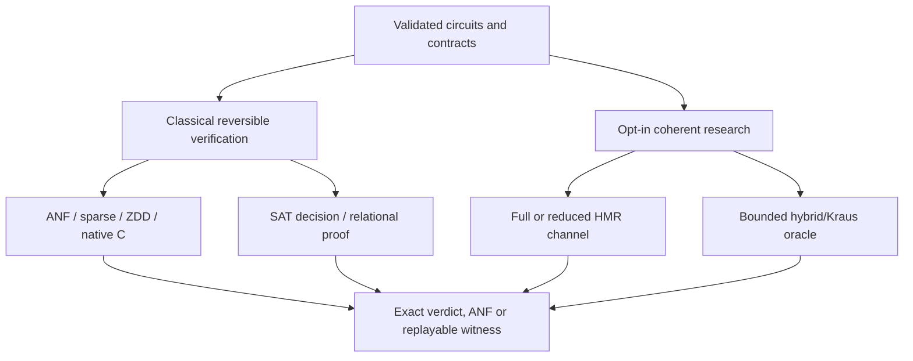

# SymQ architecture and repository map

**Purpose:** help readers find the maintained implementation, independent
oracles, research experiments and evidence without confusing their guarantees.

Start at the [project README](../README.md) for installation and a task-first
verifier guide. Run the [public demo](PUBLIC_DEMO.md) for a short walkthrough.

## One project, three different layers

All verification statements must identify their **input domain, observed
outputs, accepted operations, backend and timeout policy**.

The term *maintained* below does not imply a frozen public API. SymQ is
research software, version 0.1.0, with no stable release promise.

| Directory | Ownership and intended use |
| --- | --- |
| [`src/symq/`](../src/symq/) | Installed, maintained Python package; public entry points and optional native engine |
| [`src/symq/backends/`](../src/symq/backends/) | Exact Boolean representations, simulation, optional native C/ZDD |
| [`src/symq/sat/`](../src/symq/sat/) | Reversible Boolean SAT equivalence, explicit contracts, relational composition |
| [`src/symq/experimental/`](../src/symq/experimental/) | **Installed but opt-in** coherent channels, bounded hybrid/cyclotomic references, domains, local proofs, CLI support |
| [`tests/`](../tests/) | Executable regressions, differential tests, adverse cases, and correctness checks |
| [`examples/`](../examples/) | Runnable [public demo](../examples/public_demo.py) and versioned [experimental JSON fixtures](../examples/experimental/) |
| [`docs/`](./) | Maintained API guides, theorem boundaries, source-linked evidence and resource policies |
| [`research/`](../research/) | Prototypes, technical reports, old audits, immutable historical snapshots: **not automatically installed** |
| [`benchmarks/`](../benchmarks/) | Third-party licensed corpora, manifests, source-pinned trials, historical and qualification data |
| [`tools/`](../tools/) | Native build diagnosis, sanitizers and reproducible Qualtran fixture generator |
| [`.github/workflows/`](../.github/workflows/) | Standard CI and narrowly triggered research/audit workflows |

### Maintained classical path

A `Circuit` is validated before symbolic reasoning. Its X/CX/CCX/MCX
instructions define a reversible Boolean permutation. Every symbolic backend
represents canonical output ANFs in the Boolean ring and compares all declared
outputs for all Boolean inputs.

- [`circuit.py`](../src/symq/circuit.py) and [`qasm.py`](../src/symq/qasm.py):
  circuit IR and strict reversible OpenQASM import; unsupported quantum features
  are not silently lowered.
- [`anf.py`](../src/symq/anf.py) and [`backends/`](../src/symq/backends/):
  canonical polynomials, explicit and compressed representations, optional C.
  The ordinary native implementation is 64-variable and the explicit wide
  implementation is 128-variable; memory/term explosion is still possible.
- [`equivalence.py`](../src/symq/equivalence.py):
  full classical equivalence and replayable counterexamples.
- [`sat/`](../src/symq/sat/):
  an alternative **decision** engine with observed outputs, restored wires and
  bounded composition. SAT does **not** provide full output ANFs.
- [`resources.py`](../src/symq/resources.py):
  cooperative resource deadlines. Deadlines are not independently verified
  memory-safety proofs or hard operating-system limits.

### Quantum/measurement research path

[`phase.py`](../src/symq/phase.py) offers a narrow sign/HMR branch model,
including O1/O2 clean/output obligations. It is **not** the same theorem as
full-channel equality.

[`experimental/api.py`](../src/symq/experimental/api.py) takes explicit
`VerificationContract` inputs: full/reduced channels, coherent legal domains,
and carefully bounded observed instruments. Its [`channel.py`](../src/symq/experimental/channel.py)
tracks off-diagonal coherences of `|x><y|`; an instrument also tracks selected
classical outcomes. The [`hybrid.py`](../src/symq/experimental/hybrid.py)
oracle computes bounded exact channels independently of the compressed symbolic
path. An ordinary native 64-variable manager can represent at most 32 *paired
coherent data variables* for monolithic HMR comparison; the explicit 128-variable
mode raises that representation ceiling to 64 data bits, **not** the cost ceiling.

See [experimental API](experimental.md), [phase semantics](experimental-phases.md)
and [local composition](experimental-composition.md). A closed or invalid
contract must not silently fall back to a weaker theorem.

## Evidence ownership and provenance

`benchmarks/corpus/` holds immutable, attributed input sources:

- [QCEC circuits](../benchmarks/corpus/qcec/MANIFEST.json): third-party
  MIT-licensed corpus; previous development/holdout subsets have already
  been explored. Do not treat those labels as a fresh blind evaluation.
- [Qualtran GF2MulMBUC fixtures](../benchmarks/corpus/qualtran/README.md):
  source-pinned, Apache-2.0 normalized `m=1/2` HMR examples. Their
  [qualification report](hmr-qualification-20261030.md) is small and
  coherence-sensitive, **not** evidence of general HMR scaling.

`benchmarks/results/` and `benchmarks/qualification/` contain **recorded
experiments**, not the installed library. Keep source SHA, native-binary SHA,
raw data, licenses and timing boundaries together. Do not rewrite raw
measurements to match newer code. Some newer classical reports exist only in
unmerged PR #26 and #27; do not quote them as `main` results before integration.

`research/archive/` is historical source/evidence with independent integrity
manifests. Other `research/` directories remain useful for literature,
prototypes and negative experiments, but may describe older PR states.
Promote a capability only by separately porting it into `src/symq/`, adding
tests and documenting its *actual* accepted theorem.

This boundary is intentional. Moving sealed historical files merely for a
tidier tree can break reproduction and audit trails.

## Where correctness is checked

- Ordinary [CI](../.github/workflows/ci.yml) covers multiple Python versions,
  pure-Python operation, native wheels, optional external backends and C
  sanitizers. A green run is necessary, not a mathematical proof.
- [Tests](../tests/) include exact small-domain oracles, non-equivalent
  mutants and regression cases. The [public-demo smoke test](../tests/test_public_demo.py)
  protects the presentation workflow.
- [Roadmap status](roadmap-status.md) separates implemented research,
  rejected shortcuts and adoption gates. [Evidence](roadmap-evidence.md)
  attributes measurements to exact sources and states their limitations.
- A real compiler-generated corpus, independently inspected proof obligations
  and an author-approved manuscript are still separate research/publication
  requirements; see [public readiness](PUBLIC_READINESS.md).

**Do not conflate:** equality on computational-basis inputs, full coherent
channel equality, reduced channel equality, and observed classical-instrument
equality. They are distinct propositions even when one toy example passes all.
