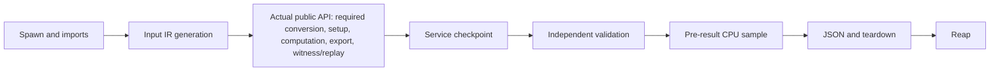

# Classical benchmark qualification, 30 October 2026

**Completed bounded study, experimental evidence.** Results qualify only the
recorded synthetic cases, services, source and resource policy; broader
competitiveness and stable-API promotion remain unestablished.

The ABI repair for PR #26 binds the native harness to the actual ABI-5 tuple,
loaded extension and build receipt. It retains the historical ABI-4 measurements
under their original source/binary identities. Issue #43 was closed after the
repair at `d893fa3f7cadeb52120e1ed8150bdc2b5c7bde8d` passed eight CI jobs.
The 178 historical corpus/result files remain byte-identical.

The comparison protocol was frozen at
`49f5c438fe8916d2d2abf0a1dd137c33fd752184`, based on integrated main
`332de59677bd5e21a125c5d6f6f5f43264b4b734`. It passed eight exact-source CI jobs
([run 40976700627](https://github.com/yoch/symq/actions/runs/40976700627)).
A separate development-only qualification exercised all nine configurations,
four tasks and three boundaries in 108 fresh workers: 93 `ok`, 15 expected
`unsupported`, no error. These are protocol checks, not blind performance data.

The selected study requests 2,700 workers: five cases, four tasks, nine
configurations and fifteen paired repetitions. The three unselected manifest
cases remain 1,620 `not_run` cells. Selection, sources, binary, order seed and
budgets are fixed. No case is replaced or rerun in response to its result.

One protocol qualification defect was found by inspecting the generator, without
consulting paired timing ratios: increment ignores its seed, so its width-matched
tests had already generated the same circuit. The recorded and published
classification erratum treats it as development calibration. It preserves raw
labels and the preregistered mixed-study aggregate, with a separate holdout-only
sensitivity. The two small stochastic families in that sensitivity do not
support population-level inference. The adverse fresh cases share one synthetic
family and are not external optimizer outputs.

"Fresh holdout" describes first evaluation in this fixed study. Its selected
cases become explored evidence after this evaluation and are not an untouched
holdout for future optimization. Unselected affine-10/shear-10 remain `not_run`;
increment-10 was already deterministic calibration. A genuinely confirmatory
successor needs new source-controlled external cases or fresh seeds. The reason
for that successor is limited scientific evidence, not an invented resource
blockage; the frozen raw labels remain historical records.

The frozen worker has further explicit limits: public-call wall, service CPU,
validation CPU and whole-worker wall have different boundaries; raw cumulative
CPU excludes JSON encoding/teardown; cleanup is not separately instrumented;
whole-worker RSS includes all optional library imports. Representation-specific
node/term guards supplement common process limits and do not define equal
abstract work. The future-only harness correction at
`c502a44331f09c599f2b4593eaa5c85a684a173c` measures CPU after reaping and marks
cleanup uninstrumented; it does not retroactively change the measured data.

The successful-service timing path is:

The narrow public `service_seconds` timer covers C, excluding IR generation and
independent validation. The service wall/CPU budget covers B through D; E has its
own budget. Whole-worker wall reaches reaping and parent result handling. The
recorded cumulative CPU stops at F, so full reaped-worker CPU is unavailable in
this campaign. The raw `cleanup: 0` placeholder is not a measured zero cost for G.
Public-API internals are included in C but not individually timed; failed or
unsupported calls do not necessarily traverse the full successful path.

Campaign workers run serially on CPU 0. Lightweight focused development tests
ran on CPU 4 during the study, typically about three seconds per invocation;
one fake-child regression touched approximately 32 MiB for an RSS-limit kill
test. Normal maintenance and read-only monitoring also occurred. There was no
concurrent heavy benchmark campaign, but no idle-host or physical CPU/memory/I/O
exclusivity guarantee is made. This operator disclosure is not a per-trial
contention trace and does not justify removing observations or adjusting times.

See the [artifact protocol and reproduction commands](../benchmarks/qualification/classical-20261030/README.md)
and its source/binary receipts. Final results, status denominators, pair/family
analysis and explicit unknowns follow below.
No backend default, stable API theorem, external publication or merge is changed.

## Completed results and explicit unknowns

All 2,700 selected workers finished. The 4,320-cell grid contains **1,560 `ok`,
525 service-CPU `timeout`, 240 manager-node-limit `inconclusive`, 375
`unsupported`, and 1,620 `not_run`** cells. No `error`, OOM or unexplained
`killed` category occurred. All 525 CPU timeouts were terminated with SIGKILL;
zero unexplained kills does not mean no process was killed. There were no
validation-stage timeouts in this study.

There are 1,395 successful requested services checked by the exhaustive
small-instance oracle. The raw 1,440 `oracle_checked` flags additionally include
45 checked QCEC negative decisions that could not supply the requested witness;
those remain `unsupported` services. There are 405 concrete replayed witnesses,
345 completed ANF exports (315 exhaustively checked), and 2,175 returned
per-worker provenance records. The 525 interrupted workers have no returned
result receipt; controller snapshot checks surround every attempted worker.
No receipt is an independently checked proof certificate.

QCEC returned 75 `equivalent` positive decisions and 75 `not_equivalent` negative
decisions, with no `probably_*` or unknown verdict. The 75 negative
counterexample services remain unsupported because the adapter exposes no
concrete input. The pinned configuration uses only its complete alternating
checker, with simulation, ZX, construction and parallel checkers disabled.
Its external engine decisions remain distinct from an independently controlled
certificate. Source and raw verdict counts are retained in the [receipt](../benchmarks/qualification/classical-20261030/receipt.json).

The following table includes every case; each selected case has 540 requested
trials. Counts describe this joint resource policy, not equal abstract work.

| Case | Classification | ok | timeout | inconclusive | unsupported | not_run |
| --- | --- | ---: | ---: | ---: | ---: | ---: |
| fresh-affine-4 | fresh_stochastic_holdout | 465 | 0 | 0 | 75 | 0 |
| fresh-shear-5 | fresh_stochastic_holdout | 465 | 0 | 0 | 75 | 0 |
| fresh-increment-5 | development_calibration | 465 | 0 | 0 | 75 | 0 |
| fresh-affine-10 | fresh_stochastic_holdout | 0 | 0 | 0 | 0 | 540 |
| fresh-shear-10 | fresh_stochastic_holdout | 0 | 0 | 0 | 0 | 540 |
| fresh-increment-10 | development_calibration | 0 | 0 | 0 | 0 | 540 |
| adverse-nonlinear-14 | fresh_adverse_holdout | 150 | 195 | 120 | 75 | 0 |
| adverse-nonlinear-18 | fresh_adverse_holdout | 15 | 330 | 120 | 75 | 0 |

At width 14, CUDD BDD/ZDD complete all four requested tasks, while both native
configurations hit the allocated-manager-node cap. Sparse/Python ZDD/PolyBoRi
hit the CPU cap. SAT completes the counterexample task but times out proving
equivalence. QCEC decides both signs but supplies no witness. At width 18,
only QCEC completes the positive-equivalence service; every other eligible
requested service reaches its recorded guard, and QCEC's negative witness
service remains unsupported. No all-input exhaustive oracle was run above ten
wires. These are observed frontiers on two synthetic streams, not intrinsic
lower bounds or representative external-compiler results. In particular, the
native cap counts allocated manager nodes and intermediate history; it does not
prove the final reachable DAG or final ANF inherently requires that allocation.

On the three small cases (two fresh stochastic cases plus deterministic increment
calibration), all eligible requested services complete. The table gives pooled
public-call medians over 45 observations per supported cell, in milliseconds.
These descriptive absolute medians are not the family-balanced paired ratios;
the latter remain in the [machine-readable report](../benchmarks/qualification/classical-20261030/report.json), with eligibility counts, case medians, family
effects, descriptive cluster intervals and leave-one-family-out sensitivity.

| Configuration | simulate ms | ANF-export ms | equivalence ms | counterexample ms |
| --- | ---: | ---: | ---: | ---: |
| sparse | 0.0899 | 0.1467 | 0.1732 | 0.2612 |
| zdd | 0.1506 | 0.2175 | 0.2592 | 0.3336 |
| zdd-native | 0.1437 | 0.2252 | 0.2368 | 0.2709 |
| zdd-native-fused | 0.0816 | 0.1381 | 0.1295 | 0.1913 |
| polybori | 35.4267 | 36.4486 | 35.8337 | 35.3105 |
| cudd-bdd | 11.0486 | 11.4085 | 11.5788 | 11.5679 |
| cudd-zdd | 10.8603 | 10.8630 | 12.0502 | 11.8057 |
| sat | unsupported | unsupported | 1.0141 | 1.0100 |
| qcec | unsupported | unsupported | 5.1518 | unsupported |

Per-call manager construction and required conversion are included in these
public times. The small calls do not amortize foreign-library setup; their large
ratios against CUDD/PolyBoRi are not isolated-kernel or general algorithm gains.
The public fused native path improves over the explicit native Python loop on
these tiny cases, but fails all requested large-case services under the manager
cap. This study supports a narrow implementation observation, not a new default
or an external compiler speedup. The median complete worker wall is
697.894 ms; observed RSS ranges from
96.832 to 340.945 MiB and includes the shared
optional-library prefix. Full reaped CPU is unavailable for this source.

Raw JSON: 8,793,430 bytes, SHA-256
`20810d3735be03677f5245f695dd01683d483b6be8b0494ec6d42615a2d95573`.
Published gzip: 488,720 bytes, SHA-256
`797e79198d67d5a6af5fa66b822d1e6936281765bf5916488763f302b6f298c2`.
The raw result-file mtime is `2026-10-30T01:00:56.623659+00:00`;
the controller's exit was observed at `2026-10-30T01:01:02Z`. These are explicitly
identified observations, not a fabricated precise experimental end.

The reproducible mechanical qualification is complete, including separate
source-mutation, CPU-after-teardown and actual RSS-kill regression tests. A broader
confirmatory external study remains scientifically necessary: this corpus is
synthetic, has only two fresh small stochastic families, includes the disclosed
calibration-label correction, and lacks full reaped CPU in the measured source.
This is an evidence limitation, not an invented lack of accessible resources.
The selected cases are now explored and cannot be reused as untouched holdout.
